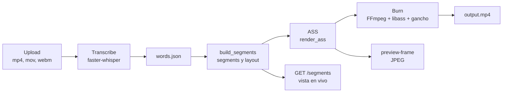

# Plataforma de subtítulos para shorts

Sube un video vertical, transcribe el audio en tu máquina con faster-whisper y quema los subtítulos en el MP4 con FFmpeg y libass.
El editor trae 11 presets, un gancho de apertura opcional y una vista previa que dibuja el fotograma con el mismo ASS y libass que el render final.
Cambiar el estilo o las palabras no vuelve a transcribir: los segmentos y el ASS se regeneran desde `words.json`.

## Requisitos

- **macOS:** `brew install ffmpeg-full python@3.12`. `ffmpeg-full` es keg-only: vive en `/opt/homebrew/opt/ffmpeg-full/bin/` y no reemplaza el `ffmpeg` del sistema. El motor lo busca antes que en el PATH.
- **Linux:** FFmpeg con libass. Comprueba el filtro con `ffmpeg -hide_banner -filters | grep " ass "`.
- **Python 3.12.** No uses 3.14: faster-whisper no es fiable ahí.
- **Espacio en disco.** Cada job guarda en `data/jobs/<id>/` el video original, el audio WAV, las palabras, el ASS, el MP4 y las miniaturas. Al volver a renderizar, el MP4 nuevo se escribe como `output.partial.mp4` junto al anterior: mientras corre, la carpeta del job ocupa hasta unas tres veces el tamaño del video (original, MP4 anterior y parcial). La aplicación no comprueba el espacio libre. Si el disco se llena, el render termina en `error` y el mensaje incluye lo que devolvió FFmpeg.

## Instalación

```bash
python3.12 -m venv .venv
.venv/bin/pip install -r requirements.txt -r backend/requirements.txt
```

`requirements.txt` cubre el motor: transcripción, Pillow para el gancho, fonttools y uharfbuzz para las medidas de texto, y pytest. `backend/requirements.txt` cubre la API.

Las instancias estáticas de Montserrat e Inter ya están en `assets/fonts/`. `python -m engine.static_fonts` las regenera desde sus archivos variables (Montserrat-Bold, Montserrat-ExtraBold, Montserrat-Medium e Inter-SemiBold). Solo hace falta si faltan o si cambias una variable.

## Configuración

Los valores llegan por variables de entorno. Una variable vacía equivale a no definirla, y un valor no válido detiene el arranque con un mensaje que nombra la variable.

| Variable | Por defecto | Lee | Efecto |
|---|---|---|---|
| `SUBS_DATA_DIR` | `data/` | `backend/config.py` | Carpeta de jobs, base SQLite y `subs.lock`. Una ruta relativa cuelga de la raíz del proyecto. |
| `SUBS_MAX_UPLOAD_MB` | `500` | `backend/config.py` | Tamaño máximo de un video, en MB. Entero mayor que 0. Los videos se suben por trozos, así que este tamaño no depende del límite por petición de Cloudflare. |
| `SUBS_CHUNK_MB` | `8` | `backend/config.py` | Tamaño de cada trozo de la subida por partes, en MB. Entero de 1 a 90. Cloudflare corta a los 100 s las peticiones que no terminan: con el túnel a unos 0,29 MB/s, 8 MB tardan unos 28 s. |
| `SUBS_DEFAULT_MODEL` | `small` | `backend/config.py` | Modelo de Whisper si el formulario no pide `model_size`: `tiny`, `base`, `small`, `medium`, `large-v2` o `large-v3`. |
| `SUBS_MAX_PREVIEW_SECONDS` | `15` | `backend/config.py` | Duración máxima del preview de render, en segundos. El mínimo es 1. |
| `SUBS_DEFAULT_PRESET` | `ken_remedie` si el motor lo tiene; si no, `ken_classic` | `backend/config.py` | Preset si el formulario no pide `preset`. Con valor, debe existir entre los presets del motor. |
| `SUBS_CORS_ORIGINS` | vacío: solo mismo origen | `backend/config.py` | Solo para desarrollo local: orígenes que pueden llamar a la API desde otro puerto o dominio, separados por comas (p. ej. `http://localhost:5173`). Con orígenes se permiten credenciales (cookies de Cloudflare Access). |
| `SUBS_API_KEY` | vacío: la API no pide clave | `backend/acceso.py` | Si se define, toda petición a `/api/*` y `/fonts/*` debe llevar la cabecera `X-Subs-Key` con ese valor, o responde 401. Con clave, `/docs`, `/redoc`, `/openapi.json` y la interfaz no se sirven (404): los publica el Worker. |
| `FFMPEG_BIN` | ffmpeg-full de Homebrew, o el PATH | `engine/ffbin.py` | Ruta del ffmpeg. |
| `FFPROBE_BIN` | ffprobe de ffmpeg-full, o el PATH | `engine/ffbin.py` | Ruta del ffprobe. |

La CLI del motor no lee estas variables. En la imagen, `HF_HOME=/opt/hf-cache` lo lee huggingface_hub para guardar los modelos.

**Cloudflare.** En producción, el frontend y la API van por el mismo origen, a través de un proxy. Cloudflare Free rechaza los cuerpos de más de 100 MB y corta a los 100 s las peticiones que no terminan. Por eso los videos se suben en trozos de `SUBS_CHUNK_MB` (8 MB por defecto), cada uno en su propia petición (`POST /api/uploads`, `PUT /api/uploads/{id}/chunks/{n}`, `POST /api/uploads/{id}/complete` y `DELETE /api/uploads/{id}` para cancelar). La interfaz lee el límite real de `GET /api/config` (`max_upload_mb` y `max_upload_bytes`). Con `SUBS_API_KEY`, el proxy tiene que añadir `X-Subs-Key` también a las rutas `/fonts/*`. Con Cloudflare Access delante, cada subida, edición y render deja en el log del servidor, con el id del job, el correo de la cabecera `Cf-Access-Authenticated-User-Email`. Esa cabecera solo se registra: no autoriza nada.

Solo el proceso que tiene el lock `subs.lock` en `SUBS_DATA_DIR` ejecuta el worker y marca como interrumpidos los jobs que quedaron en curso. Un lock es válido mientras su pid vive y su latido tiene menos de 120 s. Un segundo proceso sobre la misma carpeta sirve la API y encola jobs, pero no toca los del primero: el worker del dueño procesa esa misma cola. Ese proceso reintenta tomar el lock cada 15 s. Si el dueño muere, en unos 15 s el siguiente toma el worker, marca como «interrumpido por reinicio» lo que estaba en curso y procesa la cola. Un dueño que pierde el lock deja de procesar jobs.

## Uso

### Arrancar

```bash
scripts/dev.sh                                             # http://127.0.0.1:8765
PORT=8766 scripts/dev.sh                                   # otro puerto
SUBS_DATA_DIR=/ruta/de/pruebas PORT=8766 scripts/dev.sh    # otra carpeta de datos
```

En macOS, el script avisa si falta `ffmpeg-full`. La API arranca igual, pero sin libass no hay render.

### Flujo en el editor

1. **Subir.** Elige un video mp4, mov o webm (hasta `SUBS_MAX_UPLOAD_MB`, 1 GB (1024 MB) por defecto) y el idioma: automático, español o inglés. El archivo viaja por partes; ver [Subidas por partes](#subidas-por-partes).
2. **Transcribir.** El job pasa por `transcribing` hasta `ready`. Mientras tanto, las ediciones responden 409.
3. **Preset.** La tarjeta *Preset* elige el estilo, y *Comparar presets* compara varios. La vista en vivo pide `GET /api/jobs/{id}/segments` con el estilo candidato, sin guardarlo. El estilo se guarda con `PUT /style` tras una pausa corta.
4. **Gancho.** La tarjeta *Gancho de apertura* añade el titular de los primeros segundos (ver abajo).
5. **Palabras y estilo.** Corrige el texto o los tiempos de cada palabra y guárdalos. Los cambios de estilo regeneran el ASS sin volver a transcribir.
6. **Exportar.** En *Exportar* renderizas un preview o el video completo, y descargas el MP4 cuando termina.

### Subidas por partes

Un archivo se sube en trozos de `chunk_bytes` (8 MB por defecto), y cada trozo es una petición aparte. La interfaz lo hace sola: si un trozo falla, lo reintenta tres veces, con esperas de 1, 3 y 9 s. Si eliges otra vez el mismo archivo, el servidor dice qué trozos tiene y solo se envían los que faltan. Para cancelar, `DELETE /api/uploads/{id}` borra los trozos al momento (204). Responde 404 si la subida no existe y 409 si se está completando. Una subida sin actividad durante 24 h se borra.

Por API, el orden es este. Si `SUBS_API_KEY` está definida, añade `-H "X-Subs-Key: $SUBS_API_KEY"` a cada petición.

1. `POST /api/uploads` con `{"filename", "size", "content_type"}` devuelve `upload_id`, `chunk_size` y `total_chunks`. Responde 400 si la extensión no es de video, 413 si el archivo supera `SUBS_MAX_UPLOAD_MB` y 507 si no hay espacio libre.
2. `PUT /api/uploads/{upload_id}/chunks/{n}` manda el trozo `n` como cuerpo crudo, con `n` de 0 a `total_chunks - 1`. Todos miden `chunk_size`, salvo el último. Reenviar un trozo lo sustituye. Responde 409 si `n` está fuera de rango y 413 si el trozo supera `chunk_size`.
3. `GET /api/uploads/{upload_id}` devuelve `received`, la lista de trozos que ya llegaron. Sirve para reanudar.
4. `POST /api/uploads/{upload_id}/complete` arma el archivo y devuelve `job_id`. Acepta `preset`, `overrides`, `language` y `model_size`, todos opcionales, como `POST /api/jobs`. Responde 409 si faltan trozos y 400 si el tamaño no cuadra.

```bash
curl -X POST -H "Content-Type: application/json" \
  -d '{"filename":"video.mp4","size":123456789,"content_type":"video/mp4"}' \
  http://127.0.0.1:8765/api/uploads
curl -X PUT --data-binary @trozo-0.bin http://127.0.0.1:8765/api/uploads/<upload_id>/chunks/0
curl -X POST -H "Content-Type: application/json" -d '{"preset":"ken_remedie"}' \
  http://127.0.0.1:8765/api/uploads/<upload_id>/complete
```

`POST /api/jobs` sigue aceptando el archivo entero en un formulario. Detrás de Cloudflare, sirve solo para archivos de hasta 100 MB.

### Gancho de apertura

El gancho es una píldora blanca con el titular, visible al principio del video durante `duration_s` segundos. Puede llevar un kicker encima, una barra roja con el título del noticiero y una barra azul con el subtítulo.

**En el editor.** Abre la tarjeta *Gancho de apertura*, que va antes de *Avanzado*, y enciende *Activar gancho*:

- *Titular*: obligatorio. Sin titular, el gancho no se guarda. Admite emojis y ocupa dos líneas como máximo.
- *Kicker*, *Título del noticiero (rojo)* y *Subtítulo del noticiero (azul)*: opcionales.
- *Duración (s)*: de 0,5 a 10. Por defecto, 3.

Los cambios se guardan 400 ms después del último. Al apagar el gancho se guarda `null`. La interfaz limita los textos a 80, 40, 30 y 50 caracteres. La API admite hasta 200 en cada texto.

**Por API.** `PUT /api/jobs/{id}/hook` guarda el gancho sin renderizar y devuelve lo guardado:

```bash
curl -X PUT -H "Content-Type: application/json" \
  -d '{"headline":"Hola, hoy te comparto","kicker":"Salud","news_title":"Última hora","news_subtitle":"Pruebas","duration_s":3}' \
  http://127.0.0.1:8765/api/jobs/<id>/hook
```

Con `null` como cuerpo, quita el gancho guardado. Responde 422 si hay campos desconocidos, si falta el cuerpo, si el titular está vacío o si `duration_s` está fuera de 0,5 a 10. Responde 409 mientras el job no admite ediciones y 404 si no existe.

`POST /api/jobs/{id}/render` acepta además un campo `hook`. Si lo envías, reemplaza y guarda el gancho del job antes de renderizar. Sin él, el render usa el gancho guardado. La CLI no tiene opción de gancho.

### Vista previa exacta

```bash
curl -o frame.jpg "http://127.0.0.1:8765/api/jobs/<id>/preview-frame?preset=huajin_karaoke_azul&t=1.5&w=540"
```

`GET /api/jobs/{id}/preview-frame` devuelve un JPEG del video con los subtítulos del preset en el instante `t`, escalado a `w` píxeles de ancho (de 16 a 1080, por defecto 360, sin agrandar):

- Sin `preset` ni `overrides`, usa el estilo guardado del job. Con alguno de los dos, previsualiza ese estilo sin guardarlo.
- Sin `t`, el servidor elige el instante: el segmento con más contenido que empieza en el primer 60 % del video. Si hay gancho, prefiere uno posterior a su duración.
- Cabeceras: `X-Frame-Time` indica el instante usado. `X-Empty: 1` indica que el job no tiene palabras y el fotograma va sin subtítulos. `ETag` y `Cache-Control` permiten reutilizarlo.
- Responde 404 si el job no existe, 409 si aún no está listo, 422 si el preset o `overrides` no son válidos o si `t` queda fuera del video, y 500 si FFmpeg falla.

`GET /api/jobs/{id}/segments` acepta los mismos `preset` y `overrides`. Devuelve los segmentos que dibujaría el editor, sin guardar nada.

**Paridad entre preview y render final.** El fotograma se dibuja con el mismo ASS que el render (`build_ass`), las mismas fuentes (`fonts_for_burn`), el mismo FFmpeg con libass y el mismo gancho. Cambian el ancho (`w`), el formato JPEG y la codificación: el preview en MP4 usa `veryfast` con CRF 23, y el render final usa `medium` con CRF 18. No comparo el JPEG con el MP4 píxel a píxel. La igualdad viene de usar el mismo ASS y el mismo libass. `backend/tests/test_thumbs.py` comprueba que el subtítulo sale en su instante, y `test_hook_api.py` que el gancho llega al preview y al render, y `tests/test_layout_parity.py` compara la geometría predicha con fotogramas quemados.

### CLI

```bash
.venv/bin/python -m engine.cli VIDEO --out-dir CARPETA [--preset ken_remedie] [--set campo=valor] [--no-burn]
```

Escribe `words.json`, `subtitles.ass` y `output.mp4` en `CARPETA`. `--preset` vale `ken_remedie` por defecto. `--set` cambia un campo del estilo y puede repetirse. `--no-burn` deja solo `words.json` y `subtitles.ass`.

```bash
.venv/bin/python -m engine.cli tests/fixtures/sample_1080x1920.mp4 --out-dir tests/out/readme
```

### Tests

```bash
.venv/bin/python -m pytest -q                 # motor (tests/)
.venv/bin/python -m pytest -q backend/tests   # API
```

## Presets

| id | Nombre | Uso |
|---|---|---|
| `ken_remedie` | Ken Remedie | **Por defecto.** Playfair Display comprimida en una línea bajo el mentón, palabra en itálica, halo suave y corte seco. |
| `ken_classic` | Serif editorial | Instrument Serif en una línea, palabra en itálica y sombra difusa. |
| `serif_glow` | Serif con resaltado | Instrument Serif con la palabra activa en amarillo cálido e itálica. |
| `bold_karaoke` | Karaoke en negrita | Montserrat Bold con la palabra activa en amarillo y contorno. |
| `phrase_box` | Frase en caja | Frase completa sobre una caja negra semitransparente, con fundido. |
| `bold_caps_pop` | Mayúsculas Anton | Una palabra a la vez, en mayúsculas grandes y con pop. |
| `wellness_soft` | Bienestar suave | Barrido de crema a menta con Poppins SemiBold y fundido. |
| `minimal_mono` | Minimal | Frase completa en Poppins Medium, sin animación. |
| `huajin_editorial` | Editorial mixto | Inter SemiBold con la palabra clave en Instrument Serif itálica, revelada palabra a palabra con fundido de 100 ms. |
| `huajin_karaoke_azul` | Karaoke caja azul | Poppins ExtraBold en mayúsculas, con la palabra activa en una caja azul que salta de palabra en palabra. |
| `huajin_basico` | Básico minúsculas | Montserrat Medium en minúsculas, dos líneas centradas de unas ocho palabras y corte seco. |

## Cómo agregar un estilo

Un estilo es una entrada en `presets/presets.json`. Los campos que no escribas toman su valor por defecto. La interfaz pinta una tarjeta por cada preset que devuelve `GET /api/presets`, así que no hay nada que tocar en el frontend.

La guía completa está en [docs/ADDING_STYLES.md](docs/ADDING_STYLES.md): los 60 campos de `engine/styles.py` con tipo, rango, default y efecto, las fuentes, la verificación con la CLI y un ejemplo completo.

## Deploy

### Docker

```bash
mkdir -p data
docker compose up -d --build    # http://localhost:8000
```

- La imagen usa `python:3.12-slim`, FFmpeg de Debian (que trae libass), `fontconfig` y `fonts-noto-color-emoji` para los emojis del titular. Corre con un usuario sin privilegios (uid 1000).
- `WHISPER_MODEL` (por defecto `small`) elige el modelo que se precarga en la imagen. Con `--build-arg PRELOAD_WHISPER=0` no se precarga nada, y el primer job que use un modelo lo descarga en `/opt/hf-cache`.
- `./data` se monta en `/app/data`. En Linux, si el host no usa el uid 1000, da permisos con `sudo chown -R 1000:1000 data`.
- Para fijar variables `SUBS_*` en el contenedor, añade un bloque `environment:` al servicio de `docker-compose.yml`.
- El `HEALTHCHECK` consulta `/api/presets`.
- Pendiente: construir la imagen y probarla. Docker no estaba instalado en la máquina de desarrollo, así que el Dockerfile está revisado pero no construido.

### VPS o servicio con disco persistente

Render, Railway o Fly con un volumen montado en `/app/data`, con la misma imagen. Usa una sola instancia por volumen: la cola vive en SQLite dentro de ese disco, y una segunda instancia no ejecuta el worker.

### Por qué no un serverless corto

Un job tarda minutos entre transcripción y quemado, necesita binarios pesados (FFmpeg con libass y el modelo de Whisper) y guarda su estado en disco. Una función con tiempo de ejecución y disco efímeros no encaja.

## Arquitectura



**Segments y layout son la única fuente de verdad.** `engine/layout.py` (`build_segments`) decide las frases, los tiempos, el énfasis, los cortes de línea y la geometría de cada bloque. `engine/geometry.py` calcula esa geometría con las métricas reales de la fuente. El ASS (`render_ass`), el preview, el fotograma y el overlay del editor leen esa misma salida. Por eso el editor no recalcula nada: pide `GET /api/jobs/{id}/segments`.

**Design system.** La interfaz usa Click-Flow Design System v6, adaptado a subtítulos. Los tokens están en `frontend/css/tokens.css`, como variables `--cf-*` en modo claro. Los componentes están en `frontend/css/components.css` y el layout de la app en `frontend/css/app.css`. La página de referencia es `frontend/dev/ds.html`, que no entra en la imagen. Por diseño, nada proyecta sombra: el sistema usa anillos e insets.

```text
engine/           motor: audio, transcripción, léxico de énfasis, layout y geometría,
                  ASS, quemado, gancho (hook.py), métricas de texto, timeline, pipeline y CLI
backend/          API FastAPI (app.py), configuración SUBS_* (config.py), cola SQLite y lock
                  (jobs.py), miniaturas (thumbs.py), puente al motor y precalentamiento
frontend/         interfaz estática sin build
frontend/css/     tokens.css (Click-Flow v6), components.css y app.css
frontend/dev/     páginas de desarrollo, como ds.html (no entran en la imagen)
presets/          presets.json, stopwords.json y emphasis_lexicon.json
assets/fonts/     fuentes estáticas y variables, con sus licencias OFL
tests/            pruebas del motor y fixtures de video
backend/tests/    pruebas de la API
scripts/dev.sh    arranque local
docs/             guía para agregar estilos
data/             generado: jobs/, jobs.db y subs.lock (no va a git)
```

## Limitaciones conocidas

- Un worker por carpeta de datos. Una segunda instancia sobre la misma `SUBS_DATA_DIR` sirve la API y toma el worker si el dueño muere. No uses `--workers`.
- Si el proceso dueño del lock se reinicia, los jobs en curso pasan a `error` con "interrumpido por reinicio". Si falló la transcripción, hay que subir el video de nuevo. Si falló el quemado, la API acepta pedir el render otra vez.
- Sin libass no hay render: `POST /api/jobs/{id}/render` y `GET /api/jobs/{id}/preview-frame` responden 501. La API arranca igual y puede transcribir.
- El diseño es para video vertical 1080x1920. Los valores se escalan por alto, así que en horizontal el texto sale pequeño.
- Los presets se leen una vez por proceso: reinicia el servidor después de editarlos.
- Las fuentes deben ser estáticas (`.ttf` u `.otf`). Los archivos variables, con `[` en el nombre, se excluyen de la medida y del quemado.
- La calidad por palabra depende de Whisper. `small` es el modelo por defecto.
- No hay autenticación de usuarios: solo la clave opcional `SUBS_API_KEY`. Subir o renderizar exige espacio libre: al menos 500 MB, o el triple del video si pesa más (en subidas por partes, el triple más 500 MB). Si no hay, responde 507. `data/` crece con cada job.
- Los presets son aproximaciones a los estilos de referencia. No son copias de las cuentas.

## Publicar en Cloudflare

El sitio público es un Worker de Cloudflare con assets estáticos (`deploy/cloudflare/worker.js` y `wrangler.jsonc`). Cloudflare Pages ya no se puede crear con wrangler 4.151.1: esa CLI delega los proyectos Pages en Workers.

### Arquitectura

- **Puerta de acceso.** La contraseña del sitio (`SITE_PASSWORD`) abre una sesión: cookie `HttpOnly`, `Secure` y `SameSite=Lax`, firmada con `SESSION_SECRET`, de 30 días. Sin sesión, todo redirige a `/login`, salvo el CSS del sistema de diseño y el logo.
- **Proxy.** `/api/*` y `/fonts/*` se reenvían a `BACKEND_URL` con la cabecera `X-Subs-Key`, así que la clave nunca llega al navegador. El cuerpo viaja en streaming: subidas y descargas no pasan por memoria. Si el backend no responde (502, 503, 504 o 530 de Cloudflare, o un fallo de red), el Worker contesta con una página que se reintenta sola cada 10 s si es una navegación, o con JSON 503 y `detail` si lo pide la app.
- **Backend.** Corre en este Mac como dos LaunchAgents, desde el clon `~/Services/clickflow-subs` (ver [Runtime y launchd](#runtime-y-launchd)). Sirve uvicorn en el 8765 y lo publica con un túnel rápido de Cloudflare (`cloudflared tunnel --url http://127.0.0.1:8765`), sin cuenta ni dominio.

### Comandos

```bash
deploy/cloudflare/deploy.sh                                   # genera build/, despliega el Worker y sube los secretos
deploy/cloudflare/install-launchd.sh [install|status|uninstall]    # agentes de launchd
deploy/cloudflare/update-runtime.sh                               # trae GitHub al runtime y reinicia los agentes
```

Los secretos están en `deploy/cloudflare/.secrets.env` (permisos 600, ignorado por git). `deploy.sh` genera solo los que faltan: la contraseña del sitio se muestra únicamente en la primera ejecución.

### Cambiar la contraseña

Edita `SITE_PASSWORD` en `deploy/cloudflare/.secrets.env` y vuelve a ejecutar `deploy/cloudflare/deploy.sh`. Para cerrar todas las sesiones abiertas, cambia `SESSION_SECRET` del mismo modo: las cookies firmadas con el valor anterior dejan de valer.

### Runtime y launchd

El backend y el túnel no corren desde la copia de trabajo en `~/Documents`: launchd no puede leer esa carpeta sin acceso total al disco. Corren desde un clon de Git en `~/Services/clickflow-subs`, con su propio `.venv` y su copia de `deploy/cloudflare/.secrets.env` (permisos 600). Los datos están fuera del repositorio, en `~/Services/clickflow-subs-data` (`SUBS_DATA_DIR`), y `update-runtime.sh` no los toca.

| Agente | Ejecuta | Logs |
|---|---|---|
| `com.clickflow.subs` | `run-backend.sh`: uvicorn en el 8765 | `logs/backend.log` |
| `com.clickflow.subs-tunnel` | `tunnel.sh`: cloudflared y el vigilante | `logs/tunnel.log`, `logs/cloudflared.log` |

Los dos agentes arrancan al iniciar sesión (`RunAtLoad`) y se reinician si paran (`KeepAlive`, con 10 s de pausa). `caffeinate -s` evita que el Mac se duerma mientras el backend corre con corriente.

```bash
cd ~/Services/clickflow-subs
deploy/cloudflare/install-launchd.sh status     # cargados, con su pid
deploy/cloudflare/install-launchd.sh install    # carga o recarga los dos agentes
tail -f ~/Services/clickflow-subs-data/logs/tunnel.log
```

**Vigilante.** Cada 60 s, `tunnel.sh` comprueba el backend en local, el túnel y el camino completo Worker → túnel. Si el túnel falla 3 veces seguidas con el backend sano, reinicia cloudflared. Si el Worker falla 3 veces seguidas con el túnel sano, vuelve a fijar `BACKEND_URL`. Si la red cae al actualizar el secreto, reintenta con esperas de 5 s a 60 s. Cada evento queda en `tunnel.log`.

**Actualizar.** Trabaja en `~/Documents`, haz commit y push a `main` y ejecuta `deploy/cloudflare/update-runtime.sh` desde el runtime. El script hace `git pull --ff-only`, instala dependencias solo si cambió un requirements, reinicia los dos agentes y comprueba que responden. Si el clon tiene cambios sin commit, se detiene.

**Secretos.** El `.secrets.env` del runtime es el que cuenta, porque `BACKEND_URL` cambia cada vez que cambia el túnel. No ejecutes `deploy.sh` desde la copia de `~/Documents`: su `BACKEND_URL` queda desactualizado en cuanto el túnel cambia.

### Límites

- **Subida: 1 GB (1024 MB) por archivo, en partes de 8 MB.** Cloudflare corta a los 100 s las peticiones que no terminan. El Worker reenvía cada parte en streaming, sin leerla entera. Las subidas grandes van por partes: ver [Subidas por partes](#subidas-por-partes).
- **El Mac tiene que estar encendido y con red.** `caffeinate -s` solo impide la suspensión con corriente: con la tapa cerrada y sin pantalla externa, el Mac se duerme.
- **Arranque tras un reinicio.** Los agentes arrancan al iniciar sesión. Con FileVault, tras reiniciar hay que introducir la contraseña, y el sitio no vuelve hasta entonces.
- **Comandos de energía recomendados.** Los ejecuta el dueño, porque piden sudo: `sudo pmset -c sleep 0 disksleep 0` (no dormir con corriente) y `sudo pmset autorestart 1` (encender tras un corte de corriente).
- **La URL del túnel cambia al reiniciarlo.** `tunnel.sh` la actualiza en el Worker en pocos segundos; no hace falta redesplegar.
- **Cerrar sesión no revoca la cookie.** Sigue valiendo hasta que caduca o cambia `SESSION_SECRET`.
- **No hay límite de intentos de contraseña.** Cada intento fallido espera 800 ms. Para limitarlos de verdad, añade una regla de límite de tasa en Cloudflare.
- **Por la URL del túnel, sin clave, `/api/*` responde 401 y el resto 404.** Con `SUBS_API_KEY`, el backend no sirve la interfaz, `/docs` ni `/openapi.json`: la interfaz la sirve el Worker.
- **Con `SUBS_API_KEY` definida, el 8765 local pide clave.** Para desarrollo local sin clave, usa `PORT=8766 scripts/dev.sh`.

### Subir a un dominio propio

Con dominio, el túnel rápido se sustituye por un túnel con nombre (`cloudflared tunnel create` y una ruta DNS a `subs.tu-dominio.com`). Cloudflare Access delante de ese host añade el inicio de sesión; la contraseña del Worker puede quedarse como segunda capa.
